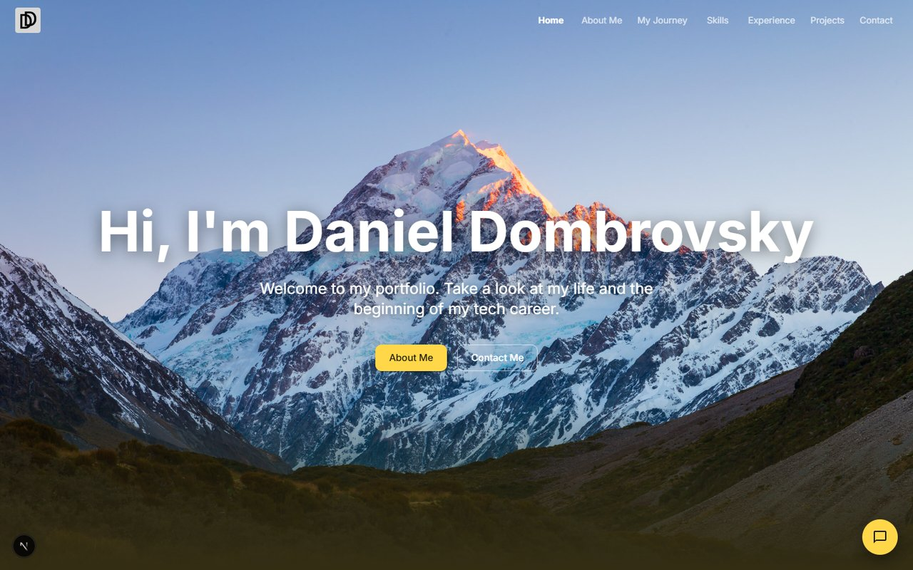

# danieldombrovsky.com

Personal site: a scrolling "journey" timeline of education, work, and projects, plus a chat widget. Each
project has its own page that embeds it from its own address: `/splendor-duel`, `/billiards`, `/mancala`,
`/barcode-scanner`, `/trip-planner` and `/call-me-maybe`. `/baby-names` offers that app as a download.



## Stack

- Next.js 15 (App Router) with static export (`output: 'export'`), React, Material UI + Emotion
- A Cloudflare Pages Function (`my-app/functions/api/chat.ts`) for the chat widget, with its spending
  limits in Workers KV.

## Layout

```
my-app/
  src/app/            pages and components (components/PageContent.tsx holds the timeline content)
  functions/api/      Cloudflare Pages Functions
  public/brand/       the site's logo
  public/logos/       school, employer and club logos
  public/people/      portraits on the timeline
  public/photos/      club photos (socis/), co-op term photos (coop/) and the group photo
  public/certificates/ certificates and nominations
  public/backgrounds/ the hero mountain, the cave, the bubble and the ocean overlay
  public/projects/    project screenshots and pictures
  public/sea/         the sea life drifting through the Experience section
```

## Local development

Requires Node 20 (see `my-app/.nvmrc`).

```bash
cd my-app
npm install
npm run dev        # site only, http://localhost:3000
npm run dev:cf     # in a second terminal: Pages Functions on :8788, proxying the dev server
```

The chat function's key goes in `my-app/.dev.vars` (gitignored) as `OPENAI_API_KEY`, and is set as a
secret on the Cloudflare Pages project.

## Deploying

Pushing to `main` deploys through Cloudflare Pages. Run `npm run build` locally first to catch type or
lint errors before pushing.
